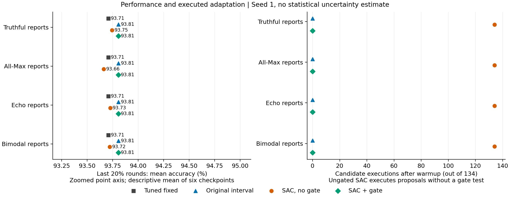

# FedTC：代码、论文与实验记录

FedTC（Federated Trust Calibration）研究在服务器没有干净验证数据、客户端更新与反馈均可能造假的情况下，如何调整联邦聚合的可信度。当前实现沿用 **FedAA 的数据划分、本地 SGD 和评测流程**。

**当前 CIFAR-10 实验使用 `FedTCStep`。** 它按客户端验证反馈选择服务器更新步长。ResNet-20 已通过合成图像的单轮启动检查，真实 CIFAR-10 的 100 轮准确率及 RL 增益待服务器实测。克隆实验分支、修改配置和提交作业见 [FedTCStep 实验指南](docs/cifar10_resnet_100.md)。

论文仍是研究原型。已归档的单种子门控实验中，原控制器与 SAC 加门控均全部回退。少数群体保护等论文主张仍待验证。

## 从哪里开始

| 内容 | 入口 |
|---|---|
| 方法、动机及版本区别 | [方法说明](docs/method.md) |
| 安装、数据和复现实验 | [复现指南](docs/reproduction.md) |
| 当前论文 | [PDF](paper/main.pdf)、[LaTeX](paper/main.tex)、[稿件状态](paper/README.md) |
| 正文与实现对应 | [公式与代码映射](docs/paper_code_mapping.md) |
| 已完成实验 | [结果索引](results/README.md) |
| 原生 MNIST 步长控制，12 个留出种子 | [逐种子动作与准确率](docs/validation/paired_feedback_20261125/native_fit/held.json)、[配对统计](docs/validation/paired_feedback_20261125/native_fit/summary.json)、[实验结论](docs/paired_feedback_findings.txt)、[复现命令](docs/paired_feedback_reproduction.txt) |
| **CIFAR-10 + ResNet-20，100 轮** | [FedAA 主入口、配置和提交命令](docs/cifar10_resnet_100.md) |
| 历史 CIFAR-10 + CifarNet 步长控制 | [数据格式、接入自检、训练与评估命令](docs/cifar10_step_control.md) |
| 全部回退的原因 | [审计记录](docs/fallback_audit.md)、[当前限制](docs/limitations.md) |
| 尚未实现的改进 | [下一版设计](docs/next_version.md) |
| 来源与整理记录 | [来源](docs/provenance.md)、[验证记录](docs/validation.md) |

## 方法版本

| 命令中的算法名称 | 含义 |
|---|---|
| `FedTCStep` | 配对接续收益拟合服务器步长，开发后冻结并在留出种子上训练分类器 |
| `FedTC` | 原确定性区间 Actor-Critic、PopArt、原门控；默认 `--td-mode paper` |
| `FedTCFixed` | 固定 `(lambda,tau)`；默认 `(0,1.35)`，可显式覆盖 |
| `FedTCSAC` | SAC，以反馈区间中点为奖励，预热后不执行门控 |
| `FedTCSACGate` | 同一 SAC，加独立的无熵端点 Critic 门控 |
| `FedAA` | 上游 DDPG 基线，仍使用其服务器干净奖励数据 |
| `FedAvg` / `RFA` / `TrimmedMean` / `MultiKrum` | 已实现的聚合基线 |

原版 FedTC 是确定性区间 Actor-Critic，不是直接调用 FedAA 的 DDPG。SAC 是对照扩展，不是正文当前算法。两个 SAC 版本才构成只改变门控开关的对照；原版与 SAC 还存在奖励和归一化差异。

## 快速开始

**CIFAR-10 + ResNet-20 单轮冒烟。** 在 `codex/mnist-paired-feedback-results` 分支的仓库根目录，激活项目 Python 环境后执行：

```bash
cd code
python -m pip install -r requirements-tested.txt
DEVICE=cpu bash scripts/run_cifar10_resnet_100.sh check
```

看到 `"checked_rounds": 1` 和 `"status": "ok"` 即完成。缺少客户端分区时，脚本临时生成 CIFAR 形状的输入。正式实验使用 24 个种子拟合、8 个种子校准；冻结后，用相同的 3 个留出种子对比各策略。留出目录的 `seed_statistics.csv` 给出全局精度和 Worst 10% 的均值与样本方差。见 [100 轮配置](code/configs/cifar10_resnet_100r.json)。

### 原版 FedTC 与 SAC 的 MNIST 实验

已验证的环境是 Python 3.9.6、PyTorch 2.6.0、CPU。以下从仓库根目录执行：

```bash
cd code
python3 -m venv .venv
.venv/bin/python -m pip install -r requirements-tested.txt
.venv/bin/python dataset/prepare_mnist.py
.venv/bin/python -m unittest discover -s tests -v
.venv/bin/python main.py --algorithm FedTC --device cpu \
  --global_rounds 20 --local_epochs 1 --batch_size 16 \
  --macro-length 2 --eval_gap 5 --output runs/fedtc_smoke
```

数据脚本下载**固定 FedAA 提交中的原始 100 客户端 MNIST 划分**并核验 202 个文件，不重新随机划分。原始数据和训练断点不提交到本仓库。上述 20 轮只用于流程检查。

SAC 四组对照（9 次固定参数搜索 + 16 次主实验）：

```bash
# 在 code/ 目录运行；完整训练有额外时间成本。
.venv/bin/python run_sac_study.py --output-root runs/new_sac_study --jobs 4
.venv/bin/python report_sac_study.py runs/new_sac_study
```

只核验已归档结果，无需下载数据、训练或模型断点：

```bash
# 在 code/ 目录运行；只依赖 Python 标准库。
python3 verify_published.py
```

## 已归档的 MNIST 门控实验结果

MNIST，seed=1，100 客户端，每组 300 轮；下表是最后 20% 轮次六个评测点的诚实客户端样本加权准确率均值。

| 验证反馈 | 固定参数 | 原 FedTC | SAC 无门控 | SAC 加门控 |
|---|---:|---:|---:|---:|
| 真实反馈 | 93.71% | 93.81% | 93.75% | 93.81% |
| All-Max | 93.71% | 93.81% | 93.66% | 93.81% |
| Echo | 93.71% | 93.81% | 93.73% | 93.81% |
| Bimodal | 93.71% | 93.81% | 93.72% | 93.81% |

所有条件都包含同值模型投毒和虚假效用；“真实反馈”不等于无攻击。原版及 SAC 加门控各有 134/134 次预热后回退，成绩相同来自相同保守执行路径。调参固定组为 `(0.5,1.35)`，保守路径为 `(0,1.35)`。单种子差异不构成显著性或方法优越性证明。



完整设置、指标和限制见[实验报告](results/sac_fourway_seed1/RESULTS.txt)。

## 仓库结构

```text
code/       可运行实现、原始框架接口、数据准备、实验脚本和测试
paper/      ICML 2026 格式的论文源文件、配图和可编译 PDF
docs/       方法解释、复现、公式映射、审计和未实现设计
results/    已完成实验的汇总、图表、压缩原始日志和校验清单
```

`code/runs/` 用于新的本地运行；`results/` 是已归档证据，请勿用新运行覆盖。仓库旧根目录实现已由此结构替换，旧版本仍可从 Git 历史查阅。

## 来源与许可

框架来源为 [Gp1g/FedAA](https://github.com/Gp1g/FedAA)，固定提交 `1fba884934cbec1b3506812d9d612e6a181b1d79`。保留原仓库 [LICENSE](LICENSE)；该文件不构成对第三方 FedAA 代码或论文模板的重新授权，详见 [THIRD_PARTY_NOTICES.md](THIRD_PARTY_NOTICES.md)。
